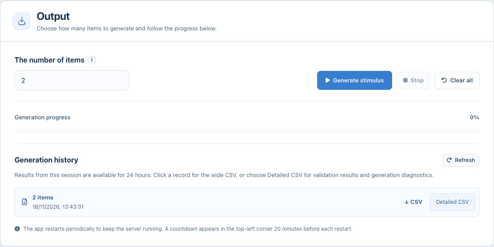

# StimMAS

**Multi-agent AI for psychological stimulus generation.**

[Open StimMAS](https://huggingface.co/spaces/CUHKLPL/stimuli_generator) · [ModelScope 创空间](https://modelscope.cn/studios/modelscopesimon/StimMAS) · [中文上手指南](#中文上手指南) · [Report an issue](https://github.com/xufengduan/Stimuli_generator/issues)

StimMAS helps psychology researchers create experimental materials from a written study design and a few examples. Describe what you need, show the tool what one complete stimulus item looks like, and download the generated items as a CSV file for review.

**New to AI tools? Start with the online app and OpenRouter.** You can follow the complete example below without writing code or installing software. OpenRouter lets you access models from different developers through one account, one API key, and the same API URL. See the [OpenRouter quickstart](https://openrouter.ai/docs/quickstart).

## Contents

- [What the three agents do](#what-the-three-agents-do)
- [Step 1: Set up OpenRouter — recommended](#step-1-openrouter)
- [Step 2: Enter example stimuli](#step-2-examples)
- [Step 3: Describe your stimulus design](#step-3-design)
- [Step 4: Set validation and scoring](#step-4-agents)
- [Step 5: Generate and download](#step-5-output)
- [Use another model or provider](#other-models)
- [Frequently asked questions](#faq)
- [中文上手指南](#中文上手指南)
- [Citation](#citation)
- [Run locally or develop the app](#local-development)

## What the three agents do

| Agent | What it does | What you provide |
| --- | --- | --- |
| **Generator** | Proposes a new stimulus item. | Example items and your study requirements. |
| **Validator** | Checks mandatory requirements; rejected items are regenerated. | Criteria that should all be true for an acceptable item. |
| **Scorer** | Rates accepted items on dimensions you choose. | Rating descriptions and minimum/maximum scores. |

These are three roles using the model you select. You only need one model configuration and one API key. Their checks and ratings help you screen materials; you should still review and pilot the materials before using them in a study.

<a id="step-1-openrouter"></a>
## Step 1: Set up OpenRouter — recommended

### 1. Create an account and get an API key

1. Open [OpenRouter](https://openrouter.ai/) and sign up or sign in.
2. Open the [API Keys page](https://openrouter.ai/settings/keys), create a key, and copy it. You can give it a recognizable name such as `StimMAS`.
3. For a paid model, add credits to your OpenRouter account through its account/billing settings. Check the model's listed prices before running a large batch. Free models can have stricter limits; see the [OpenRouter FAQ](https://openrouter.ai/docs/faq).
4. Open the [StimMAS online app](https://huggingface.co/spaces/CUHKLPL/stimuli_generator).

An **API key** is a private access code that lets StimMAS send requests using your model account. Paste the key itself, without quotation marks or the word `Bearer`. Keep it out of screenshots and shared documents. If a key is exposed, revoke it on the provider's key page and create a replacement.

### 2. Fill in Parameter Settings

For the first run, use the free OpenRouter preset, [NVIDIA Nemotron 3.5 Lightning (free)](https://openrouter.ai/nvidia/nemotron-3.5-lightning:free). Free endpoints have rate limits; start with a small batch. Find other free options in the [free text model catalog](https://openrouter.ai/models?input_modalities=text&output_modalities=text&variant=free).

| On the StimMAS page | What to select or enter |
| --- | --- |
| **Model** | Keep **Predefined Models** selected. |
| **Model Configuration → Model name** | Select **nvidia/nemotron-3.5-lightning:free (OpenRouter)** from the dropdown. |
| **API URL** | Filled automatically: `https://openrouter.ai/api/v1/chat/completions` |
| **API Key** | Paste the key you just created **on OpenRouter**. The eye button shows or hides it. |
| **Advanced Parameters** | Leave the two default rows: `max_tokens` / `Number` / `2000`; `temperature` / `Number` / `0.7`. |

Below **API Key**, **How to get an API key** links the DeepSeek, OpenRouter and OpenAI logos to their key pages. OpenRouter supports 600+ models. The **Common model names and URLs** reference appears only when you select **Custom Model**.

The page initially selects **DeepSeek**. Change the dropdown to the **OpenRouter** option before pasting an OpenRouter key. Use your OpenRouter key for this NVIDIA model; no separate NVIDIA key is needed.

**What do these unfamiliar terms mean?**

| Term | Plain-language meaning | Example for this walkthrough |
| --- | --- | --- |
| **Provider** | The service receiving the requests and charging your account. | OpenRouter |
| **Model name** | The exact identifier of the AI model to use. | `nvidia/nemotron-3.5-lightning:free` |
| **API URL** | The web address where StimMAS sends requests. It is different from the provider's homepage. | `https://openrouter.ai/api/v1/chat/completions` |
| **API Key** | Your private access code, obtained from that provider. | Your own OpenRouter key; the text in this guide is not a working key. |

StimMAS uses OpenRouter's [chat completions endpoint](https://openrouter.ai/docs/api/api-reference/chat/create-a-chat-completion). If you need to enter the URL manually, copy the **entire** address above, including `/chat/completions`.

### 3. Leave Advanced Parameters at their defaults for now

You fill in ordinary form rows; StimMAS builds the JSON automatically. There is no need to write JSON for the default settings.

| Parameter | Type | Value | Meaning |
| --- | --- | --- | --- |
| `max_tokens` | Number | `2000` | Limits the length of a model response. This is **not** the number of stimulus items. |
| `temperature` | Number | `0.7` | Controls sampling variability. A lower value generally gives less variable responses; it does not guarantee correctness. |


To add a setting later, click **Add parameter**. For example, if your chosen model supports it, enter `top_p` / `Number` / `0.9`. Parameter support varies by model, so leave unfamiliar settings alone during your first run.

<details>
<summary>Optional: parameter types and JSON preview</summary>

| Type | How to enter a value | Example syntax |
| --- | --- | --- |
| Number | Enter a number without quotes. | `2000` or `0.7` |
| Text | Enter text without surrounding quotes. | `hello` |
| Boolean | Select true or false. | `false` |
| JSON | Enter a valid structured JSON value. | `["a", "b"]` or `{"enabled": true}` |

The last two columns illustrate value syntax; they are not additional parameters to send to every model. Only add parameter names and values supported by your provider and model. Duplicate names, invalid numbers, and invalid JSON must be corrected before generation can start.

Click **JSON preview** to inspect the generated settings. With the two default rows it shows:

```json
{
  "max_tokens": 2000,
  "temperature": 0.7
}
```

The preview is read-only. Edit the form rows to change it. Remove a row with its trash button; removing every row sends an empty settings object and leaves optional parameters to the provider's defaults.

</details>

<a id="step-2-examples"></a>
## Step 2: Enter example stimuli

This walkthrough creates English sentences in **active** and **passive** voice. One item contains a verb, a name, and both sentence versions. The goal is to generate **new items following the examples**, rather than run an experiment on participants.

In **Stimulus Design → Example stimuli**, each item has two panels:

- **Condition / Example stimulus**: enter the sentence for each condition. Click **Add condition** for another row.
- **Avoid duplication → Element / Value (in this item)**: optionally name elements that must be unique across items. Click **Add element** for another row.

For this walkthrough, fill two condition rows and two element rows in each example:

| Panel | Field name | Item 1 | Item 2 | Item 3 |
| --- | --- | --- | --- | --- |
| Avoid duplication | `Verb` | eat | read | paint |
| Avoid duplication | `Name` | Alice | Ben | Clara |
| Condition | `Active Condition` | Alice eats an apple. | Ben reads the letter. | Clara paints a wall. |
| Condition | `Passive Condition` | An apple is eaten by Alice. | The letter is read by Ben. | A wall is painted by Clara. |

These are examples for you to enter, not prefilled defaults. The same verb and name appear in both sentences **within** an item; different items should use different verbs and names.

**Each item is edited independently.** Changing names, values, adding/deleting rows, or reordering in Item 1 does not modify Item 2. **Add item** creates a blank example; the copy icon duplicates an existing item so you can edit the copy. Drag row handles, or focus a handle and use the up/down arrow keys, to reorder within an item. Use the trash icons to remove rows or items.

Use consistent field names when examples illustrate the same conditions. Names must be distinct within an item, and a condition cannot share its name with an element. Fill both cells of each condition; unused element rows can be left completely blank or removed. Uniqueness elements are sent before conditions to the Generator but their standalone fields are hidden from Agent Logs. They remain in the CSV so you can check them.

<a id="step-3-design"></a>
## Step 3: Describe your stimulus design

The **Stimulus design** box starts with an editable template. Replace the bracketed prompts with your study requirements, or replace the entire box with this complete example:

```text
We are designing stimuli for an experiment investigating how active and passive voice affect sentence comprehension in adult English speakers.

Each stimulus item should contain four components in this order: Verb, Name, Active Condition, and Passive Condition.

The experiment includes two conditions:

- Active Condition: A simple English sentence in the present tense, with the named person as the agent.
- Passive Condition: A passive-voice version of the same sentence, using a by-phrase that names the same agent.

All stimuli should meet the following requirements:

- Use the same verb, name, and object in both sentences within an item.
- Give every new item a verb and a name that have not appeared in the examples or earlier generated items.
- Use common transitive verbs, familiar objects, and plausible everyday events.
- Use a singular subject and grammatically correct present-tense verb forms.
- Avoid idioms, ambiguous pronouns, and emotionally disturbing content.
- Keep the component labels exactly as Verb, Name, Active Condition, and Passive Condition.

Stimuli across conditions should be matched for meaning, vocabulary, and event plausibility. Allow the grammatical changes required to form the passive voice; the passive sentence need not have the same word count as the active sentence.
```

For your own study, specify the language, participant group, conditions, required content, exclusions, and properties to control. Only require matching that is compatible with your manipulation. For instance, active and passive sentences naturally differ in grammatical form and often in length.

<a id="step-4-agents"></a>
## Step 4: Set validation and scoring

### Validator: requirements that every item must pass

Under **Agent Property Settings → Validator**, fill the first row and click **Add Validator's property** for additional rows. These examples can be copied directly:

| Properties | Description |
| --- | --- |
| `SameMeaning` | The active and passive sentences describe the same event with the same agent and object. |
| `CorrectVoice` | Active Condition is in active voice. Passive Condition is in passive voice and contains a by-phrase naming the agent. |
| `SameVerbAndName` | Both sentences use the verb specified in Verb, with the appropriate inflection, and the name specified in Name. |
| `Grammatical` | Both sentences are grammatical English sentences in the present tense. |

Write each criterion so that **true means acceptable**. For example, use “The sentences contain no idioms,” rather than “The sentences contain idioms.” All criteria must pass for an item to be accepted.

### Scorer: dimensions for comparing accepted items

Under **Scorer**, fill all four columns. Click **Add Scorer's aspect** to add the second row:

| Aspects | Description | Min score | Max score |
| --- | --- | --- | --- |
| `Fluency` | Rate how natural and easy to read both sentences are. 0 = very unnatural; 10 = fully natural. Use the lower rating if the two sentences differ. | `0` | `10` |
| `Plausibility` | Rate how plausible the described event is in everyday life. 0 = highly implausible; 10 = highly plausible. | `0` | `10` |

Scores must have non-negative integer bounds, and the maximum must exceed the minimum. Explain the direction and endpoints in the description. A score does not have to use a 0–10 scale, and a low score does not automatically reject an item: use the Validator for mandatory requirements.

**Want help drafting these tables?** After entering your examples, design, and model settings, click **Auto-generate properties**. This calls the selected model and fills the Validator and Scorer tables. Review and edit the suggestions before generating stimuli; this step also uses your API account.

For a first run, leave **Individual Criteria Validation** and **Individual Aspect Scoring** unchecked. When enabled, these options use a separate model call for each criterion or aspect, increasing the number of calls and potentially the running time and cost.

<a id="step-5-output"></a>
## Step 5: Generate and download

1. Under **Output → The number of items**, enter `5` for a small first run.
2. Click **Generate stimulus** and keep the page open while it runs.
3. Follow the progress and the **Generator**, **Validator**, and **Scorer** panels in **Agent Logs**. Rejected proposals may be regenerated before an item is accepted.
4. When the run finishes, the app initiates a **wide CSV download**. In **Output → Generation history**, click a record to download it again, or **Detailed CSV** for validation results and generation diagnostics. Open the files in Excel, R, SPSS, or another analysis tool.

In this example, **5 items means 5 active/passive pairs: 10 sentences in total**, plus each item's Verb and Name components. The supplied examples show the desired format and are not the five new items you requested.

Each item can involve several model calls for generation, validation, scoring, and retries. Start with a small batch and check your provider's usage before generating a full stimulus set.

| Control | How to use it |
| --- | --- |
| **Stop** | Requests a stop. An in-flight model request may need to finish; completed items are saved for a partial download if available. |
| **Clear all** | Resets the form, examples, agent settings, API key, and logs. Restores the design template, default advanced parameters, and **DeepSeek** preset. Reselect OpenRouter if you use it. |
| **Agent Logs filters** | Focus on outputs, warnings/retries, or errors. Use the item selector to inspect a particular item. |
| **Raw logs** | Shows the underlying log text when you need more detail. |



### What is in the CSV?

**The default CSV is a wide table: one complete item per row, with all its condition variants together.** Column order is item ID → uniqueness elements → condition texts → scores → scoring status. Field names become column headers, instead of repeated `Key1 / Content1` pairs. Values are matched by name even if the model returns its JSON fields in a different order.

For the example above:

| item_id | Verb | Name | Active Condition | Passive Condition | score_Fluency | score_Plausibility | scoring_status |
| --- | --- | --- | --- | --- | --- | --- | --- |
| 1 | wash | David | David washes a cup. | A cup is washed by David. | 8 | 9 | complete |

Scores use the `score_` prefix and retain your aspect names. Genuine zero scores remain zero; unavailable scores are empty cells. `scoring_status` is `complete`, `partial`, `failed`, or `not_requested`, so missing ratings do not get confused with low ratings. If a user-defined field conflicts with an ID, status, score or diagnostic column, export adds a distinguishing prefix/suffix instead of overwriting either value.

**Detailed CSV** contains the same wide table plus:

| Additional column | Meaning |
| --- | --- |
| `validation_status`, `validation_<criterion>` | Final validation outcome and each criterion's true/false result. These describe the accepted proposal, not every rejected attempt. |
| `generation_attempts` | Generator calls attempted for this item, including retries. |
| `repetition_retries`, `validation_retries` | Repeated or rejected proposals for this item only. |
| `cumulative_repetition_retries`, `cumulative_validation_retries` | Those counts across the batch up to and including this item. |
| `scoring_error`, `validation_error` | Information about unavailable scores or validation errors. |
| `generated_at_utc`, `batch_id` | Batch timestamp in UTC and batch identifier. |
| `requested_items`, `completed_items` | Requested and saved item counts for the batch. |
| `stopped_by_user`, `generation_error`, `generation_message` | Stop/error information when relevant. |

Both files use **UTF-8 with BOM** for Chinese text and Excel, with standard CSV quoting for commas, quotation marks and line breaks. Download names look like `StimMAS_2026-11-18_143000_5items.csv`; partial results include `_partial`, and detailed downloads include `_detailed`. Filename dates/times use Hong Kong time; the explicitly named `generated_at_utc` diagnostic uses UTC.

History belongs to the current session URL and survives refreshes/server restarts until the session expires under the 24-hour cleanup policy. **Clear all** resets the form but keeps download history. Keep the session URL to return to it, and save the files locally for longer retention. Older history records are converted to the wide format when downloaded; per-item retry counts that were never recorded are left blank rather than inferred from cumulative counts.

For reproducibility, also save your design, examples, validation criteria, scoring scales, model ID, parameters and date. Do not include your API key in that record. Review and pilot the materials before using them in a study.

<a id="other-models"></a>
## Use another model or provider

### Find a different model on OpenRouter

**We recommend OpenRouter for trying and comparing models:** you can keep the same API URL and OpenRouter key while changing the model ID. Browse the [free model catalog with text input and output filters](https://openrouter.ai/models?input_modalities=text&output_modalities=text&variant=free).

1. Open a model's page and copy its exact identifier. For example, the [Nemotron 3.5 Lightning (free) page](https://openrouter.ai/nvidia/nemotron-3.5-lightning:free) uses `nvidia/nemotron-3.5-lightning:free`. Copy the identifier, rather than the display title “NVIDIA: Nemotron 3.5 Lightning (free)”.
2. In StimMAS, click **Custom Model**. **This clears the preset model name and API URL.** Fill in both fields again.
3. Enter your chosen identifier in **Model name**. Keep the full provider prefix, such as `nvidia/`.
4. Paste `https://openrouter.ai/api/v1/chat/completions` in **API URL** and use your **OpenRouter** key in **API Key**.
5. Check the model's price, availability, and supported parameters, then run a small pilot. StimMAS uses `json_object` for OpenRouter and other non-OpenAI endpoints, with field requirements in the prompt and application-side checks. Direct OpenAI requests retain `json_schema`. Models must support the selected output format. StimMAS needs text responses in the requested JSON format; models can differ in how reliably they follow that format.

For example, a fully filled custom configuration for the model used in the tutorial is:

```text
Model:       Custom Model
Model name:  nvidia/nemotron-3.5-lightning:free
API URL:     https://openrouter.ai/api/v1/chat/completions
API Key:     paste your own OpenRouter key here
```

### Common model names and URLs

OpenRouter is the recommended starting point; direct DeepSeek and OpenAI access are alternatives if you already use those services. The URLs below are complete chat completions endpoints.

| Provider | Example Model name | Complete API URL | Where to get the matching key |
| --- | --- | --- | --- |
| **OpenRouter — recommended** | `nvidia/nemotron-3.5-lightning:free` | `https://openrouter.ai/api/v1/chat/completions` | [OpenRouter API keys](https://openrouter.ai/settings/keys) |
| DeepSeek | `deepseek-flash` | `https://api.deepseek.com/chat/completions` | [DeepSeek API keys](https://platform.deepseek.com/api_keys) |
| OpenAI | `gpt-5.4` | `https://api.openai.com/v1/chat/completions` | [OpenAI API keys](https://platform.openai.com/api-keys) |

For the listed OpenRouter and OpenAI presets, choose the corresponding option under **Predefined Models** and paste that provider's key. The app's DeepSeek preset currently displays `deepseek-chat`; the [current DeepSeek quickstart](https://api-docs.deepseek.com/) uses `deepseek-flash`. To use the DeepSeek example above, select **Custom Model** and copy its model name and full URL from the table.

For other services, use **Custom Model** with a public HTTP(S), OpenAI-compatible chat completions endpoint; local/private endpoints and redirects are not supported. Model IDs and availability depend on the provider.

<a id="faq"></a>
## Frequently asked questions

| Question or problem | What to do |
| --- | --- |
| **Do I need to know Python, React, or JSON?** | No. Use the online app and the default parameter form. Local installation is optional. |
| **Can I use my ChatGPT login or subscription as the API key?** | Paste a key created on the selected API provider's key page. A chat account password or subscription is not an API key. |
| **The model name or API URL is blank.** | Switching to Custom Model clears both. Refill both fields, or switch to Predefined Models and select the OpenRouter preset. |
| **401 / invalid API key** | Check for extra spaces and confirm the key belongs to the selected provider. Use an OpenRouter key with the OpenRouter URL. |
| **402 / insufficient credits** | Check your provider's balance and any key spending limit. |
| **404 / model not found** | Check the full model ID and API URL. On OpenRouter, include the prefix, e.g., `nvidia/nemotron-3.5-lightning:free`. |
| **429 / rate limit** | Check the provider's rate limits and retry later. Free models may have tighter limits. |
| **Unsupported parameter / 400** | Check which parameter the provider rejects. Remove that row from Advanced Parameters and try a small run again. |
| **Invalid JSON or incomplete model response** | Try increasing `max_tokens`, simplifying the design, or choosing a model that follows structured-output instructions more reliably. |
| **Repeated validation failures** | Inspect Validator logs. Check for contradictory design requirements or criteria that an acceptable item would fail. |
| **The app seems slow.** | Multiple checks and retries can take time. Inspect the logs and provider status. Stop and wait for any partial results before retrying. |
| **No CSV appeared.** | Check browser download permissions and downloads. If no items finished before stopping, there may be no partial file. |
| **The online app is starting or reconnecting.** | Wait for the Space to start. If a connection fails, check your network; save any downloaded results before refreshing. |
| **Can AI ratings replace human norming?** | Treat them as screening information. Independently verify relevant properties, review the materials, and pilot or norm them as your study requires. |

## 中文上手指南

**第一次使用，推荐直接打开 [StimMAS 网页](https://huggingface.co/spaces/CUHKLPL/stimuli_generator)，并使用 OpenRouter。无需安装软件，也不需要会编程。**

你只需要准备几条示例材料和实验要求。StimMAS 会让三个 AI 角色依次生成材料、检查硬性要求、评价材料质量，最后下载 CSV 表格。这三个角色共用你选择的模型，不需要分别注册三个账号。

### 1. 注册 OpenRouter，拿到自己的 Key

1. 打开 [OpenRouter](https://openrouter.ai/)，注册或登录。
2. 进入 [API Keys 页面](https://openrouter.ai/settings/keys)，创建一个 Key。名称可以填 `StimMAS`，然后复制生成的 Key。
3. 如果使用付费模型，在 OpenRouter 的账户/账单设置中充值。先查看所选模型的价格，再从少量材料开始试用。免费模型也可能有调用次数限制；可以查看 [OpenRouter FAQ](https://openrouter.ai/docs/faq)。
4. 打开 [StimMAS 网页](https://huggingface.co/spaces/CUHKLPL/stimuli_generator)。

**API Key 就是让工具使用你账户的私人通行码。** 在下表对应位置粘贴你自己的 Key，不要加引号，也不要加 `Bearer`。不要把 Key 放进截图、论文附件或共享文件；如果泄露，在 OpenRouter 上撤销后重新创建。

### 2. 对照填写 Parameter Settings

网页刚打开时默认选择的是 DeepSeek，**请先改成 OpenRouter**。OpenRouter 预设使用免费模型 `nvidia/nemotron-3.5-lightning:free`。其他免费模型可以在[免费文本模型列表](https://openrouter.ai/models?input_modalities=text&output_modalities=text&variant=free)中找到；免费接口也有调用频率和额度限制，建议先少量试跑：

| 网页上的字段 | 应该怎么填 |
| --- | --- |
| **Model** | 保持 **Predefined Models**，也就是使用工具已经准备好的模型配置。 |
| **Model Configuration → Model name** | 在下拉菜单中选择 **nvidia/nemotron-3.5-lightning:free (OpenRouter)**。 |
| **API URL** | 工具自动填好：`https://openrouter.ai/api/v1/chat/completions`，无需修改。 |
| **API Key** | 粘贴刚才在 **OpenRouter** 创建的 Key。眼睛按钮可以显示或隐藏它。 |
| **Advanced Parameters** | 先保持默认两行：`max_tokens` / `Number` / `2000`；`temperature` / `Number` / `0.7`。 |

API Key 下方的 **How to get an API key** 提供 DeepSeek、OpenRouter 和 OpenAI 三个可点击的 logo，直接进入对应平台的 Key 页面。OpenRouter 旁标注支持 600+ 个模型。**Common model names and URLs** 参考表只在选择 **Custom Model** 时显示。

几个容易混淆的词，可以这样理解：

| 名称 | 含义与完整例子 |
| --- | --- |
| **Provider：服务平台** | 你注册、充值、获取 Key 的地方。本教程使用 **OpenRouter**。 |
| **Model name：模型编号** | 告诉平台要调用哪个 AI。本例是 `nvidia/nemotron-3.5-lightning:free`，包括斜杠前的 `nvidia/`。 |
| **API URL：请求地址** | StimMAS 将你的要求发往哪里。本例完整地址是 `https://openrouter.ai/api/v1/chat/completions`，不能只填 `https://openrouter.ai`。选择预设模型时会自动填写。 |
| **API Key：账户通行码** | 必须从对应平台获取。本例调用 NVIDIA 开发的模型，也用 **OpenRouter 的 Key**，不需要另一个 NVIDIA Key。 |

**强烈推荐新手使用 OpenRouter**：以后想尝试不同开发者的模型，通常只需要修改模型编号，仍然使用相同的 OpenRouter 地址和 Key。浏览你想用的模型：[免费文本模型列表](https://openrouter.ai/models?input_modalities=text&output_modalities=text&variant=free)。

Advanced Parameters 也不需要自己写 JSON：`max_tokens = 2000` 是一次回复的长度上限，**不是生成 2000 条材料**；`temperature = 0.7` 控制回答的变化程度，并不代表准确率。默认值可以先不动。点击 **JSON preview** 只是查看工具自动生成的参数。

以后需要添加参数时，点击 **Add parameter**，依次填写参数名、类型和值。例如，模型支持 `top_p` 时可以填 `top_p` / `Number` / `0.9`。不同模型支持的参数可能不同，不确定就先保留默认值。类型说明和表单截图见上方 [Advanced Parameters 说明](#step-1-openrouter)。

### 3. 填几条完整的示例材料

下面用“主动句与被动句的理解”实验作为练习。**一个 Item 是一整组材料，包含一个动词、一个人名，以及两个条件的句子。**

每个 Item 左侧是 **Condition / Example stimulus**，填写条件名称与对应句子，点击 **Add condition** 增加条件；右侧是 **Avoid duplication → Element / Value (in this item)**，填写不同 Item 之间不能重复的元素及当前示例值，点击 **Add element** 增加元素。

| 填写位置 | 名称 | Item 1 | Item 2 | Item 3 |
| --- | --- | --- | --- | --- |
| Avoid duplication | `Verb` | eat | read | paint |
| Avoid duplication | `Name` | Alice | Ben | Clara |
| Condition | `Active Condition` | Alice eats an apple. | Ben reads the letter. | Clara paints a wall. |
| Condition | `Passive Condition` | An apple is eaten by Alice. | The letter is read by Ben. | A wall is painted by Clara. |

以上内容是填写示例，不是网页默认值。同一 Item 的主被动句共享动词和人名；不同 Item 使用不同的动词和人名。

**每个 Item 独立编辑**，名称、内容、增删行和排序都不会影响其他 Item。**Add item** 新建空白示例，复制图标复制一整条示例；拖动行把手或聚焦后按上下方向键可以调整当前 Item 的行序，垃圾桶图标用于删除。

相同条件建议使用一致的名称；同一 Item 内不能重名，条件与去重元素也不能同名。条件的两格都要填好；不需要的去重行可以整行留空或删除。去重元素会排在条件之前一起发给 Generator，它们的独立字段不会出现在 Agent Logs，但会保留在 CSV 中便于检查。

### 4. 填写 Stimulus design

这个框是写给 AI 的材料要求。网页里的方括号内容是待替换的提示，请不要原样保留。第一次可以直接复制以下完整内容，生成英文主被动句材料：

```text
我们正在为一项研究英语主动句与被动句理解的实验设计材料，参与者为成年英语使用者。

每个 Item 按以下顺序包含四个组件：Verb、Name、Active Condition、Passive Condition。组件标签必须保持这四个英文名称。

实验包含两个条件：
- Active Condition：使用一般现在时的简单英语主动句，人名指代动作的执行者。
- Passive Condition：与主动句含义相同的被动句，用 by 短语注明同一个动作执行者。

所有材料必须符合以下要求：
- 同一 Item 的两个句子使用相同的动词、人名和宾语，并使用正确的词形变化。
- 每个新 Item 的动词和人名都不能与示例或此前生成的 Item 重复。
- 使用常见及物动词、常见物体和合理的日常事件。
- 使用单数主语和语法正确的一般现在时。
- 避免习语、指代不清的代词，以及令人不适的情绪性内容。

两个条件应在含义、词汇和事件合理性上匹配。允许被动语态所需的语法变化，不要求两个句子的词数完全相同。
```

改成自己的实验时，交代清楚研究问题、材料语言、参与者、条件、必须包含/必须避免的内容，以及需要控制的属性。不要同时提出互相冲突的要求。

### 5. 配置 Validator 和 Scorer

**Validator 是硬性检查：每条要求都满足才接受这个 Item。** 在 **Agent Property Settings → Validator** 中，第一列 **Properties** 填一个简短名称，第二列 **Description** 填具体判断标准。用 **Add Validator's property** 增加行：

| Properties | Description |
| --- | --- |
| `SameMeaning` | 主动句与被动句描述相同事件，动作执行者和宾语相同。 |
| `CorrectVoice` | Active Condition 是主动句；Passive Condition 是被动句，并含有注明同一执行者的 by 短语。 |
| `SameVerbAndName` | 两个句子都使用 Verb 中指定的动词及其正确词形，并使用 Name 中指定的人名。 |
| `Grammatical` | 两个句子都是语法正确的一般现在时英语句子。 |

每条标准都写成“满足时应当返回 true”的形式。例如写“句子不含习语”，不要写“句子含有习语”。

**Scorer 是质量评分，便于你之后排序和筛选。** 填写 **Aspects**、**Description**、**Min score**、**Max score** 四列，用 **Add Scorer's aspect** 增加行：

| Aspects | Description | Min score | Max score |
| --- | --- | --- | --- |
| `Fluency` | 评价两个句子的自然流畅程度。0 = 非常不自然；10 = 完全自然。如果两句表现不同，取较低的一句作为本项评分。 | `0` | `10` |
| `Plausibility` | 评价句子描述的事件在日常生活中的合理程度。0 = 极不合理；10 = 非常合理。 | `0` | `10` |

分数上下限填非负整数，最大值要大于最小值。低分不会自动淘汰材料；必须满足的要求应当放在 Validator 中。AI 评分也需要研究者检查。

也可以在填好模型、示例和实验要求后，点击 **Auto-generate properties** 让 AI 起草这两个表格，然后自己检查、修改。这一步同样会调用模型、使用 API 额度。

第一次使用时，保持 **Individual Criteria Validation** 和 **Individual Aspect Scoring** 不勾选。勾选后会为每条标准/每个评分维度单独调用模型，调用次数和耗时、费用都可能增加。

### 6. 先生成 5 个 Item，再下载检查

1. 在 **Output → The number of items** 填 `5`。这表示生成 5 组新材料，也就是本例的 5 对主被动句，共 10 个句子。
2. 点击 **Generate stimulus**，保持页面打开。下方 **Agent Logs** 可以看到生成、检查、评分和重试的过程。
3. 完成后网页会自动下载默认宽表 CSV。在 **Output → Generation history** 中点击记录可以再次下载，点击 **Detailed CSV** 下载详细版。用 Excel、R 或 SPSS 打开。
4. 逐条检查内容与评分，再决定是否扩大生成数量。生成一条材料可能需要多次模型调用，先看小批量结果和平台用量，再运行整套材料。

默认 CSV **每行是一整组 Item**，所有条件并排，列顺序为 `item_id → element → condition 内容 → score_评分维度 → scoring_status`。例如 `Verb`、`Name`、`Active Condition`、`Passive Condition` 直接作为列名，不再使用重复的 `Key1 / Content1`。模型返回字段的顺序变化不会导致内容错列。

评分列如 `score_Fluency` 保留真实的 0 分，缺失评分保持空白。`scoring_status` 用 `complete`（完整）、`partial`（部分）、`failed`（全部未取得）或 `not_requested`（未请求评分）标明状态。

**Detailed CSV** 在同一张宽表后增加每条验证标准的结果、当前 Item 的生成尝试/重复/验证重试次数、整批累计次数、评分错误与批次信息。最终验证结果不再叫“失败原因”；它表示最后一条被接收材料的检查结果，不是全部重试日志。旧结果无法还原的每条重试次数保持空白。

两种文件都使用 **UTF-8 BOM**，兼容中文与 Excel，并正确保留逗号、引号和换行。文件名包含香港时间和条数，部分结果加 `_partial`，详细版加 `_detailed`。历史记录属于当前会话 URL，刷新或服务重启后仍可下载，保留到会话按 24 小时策略清理；**Clear all 不会删除历史下载**。请保存会话链接，并把结果文件下载到本地长期保留。完整列说明见上方 [CSV 说明](#step-5-output)。

**Stop** 会请求停止，可能需要等待正在执行的请求结束；如果已有完成的 Item，会保存并下载部分结果。**Clear all** 会重置整个表单并清除 Key，模型也会恢复到 DeepSeek；再次使用 OpenRouter 时要重新选择。

下载并保存 CSV，同时保留实验要求、示例、检查与评分标准、模型编号、参数和运行日期，便于以后复现。不要把 Key 一起保存到共享记录中。正式使用材料前，仍需按研究需要进行人工审核、预实验或常模评定。

### 7. 换一个 OpenRouter 模型怎么填？

在这个 [免费文本模型列表](https://openrouter.ai/models?input_modalities=text&output_modalities=text&variant=free) 中打开模型页面，复制完整模型编号。例如 [Nemotron 3.5 Lightning (free)](https://openrouter.ai/nvidia/nemotron-3.5-lightning:free) 的编号是 `nvidia/nemotron-3.5-lightning:free`，不是页面显示标题 `NVIDIA: Nemotron 3.5 Lightning (free)`。

回到 StimMAS 点击 **Custom Model**。这会清空模型名称和 URL，需要把下面两项都填上：

```text
Model name：nvidia/nemotron-3.5-lightning:free（换模型时，替换为那个模型的完整编号）
API URL：https://openrouter.ai/api/v1/chat/completions
API Key：粘贴你自己的 OpenRouter Key
```

地址和 Key 保持不变，只替换模型编号即可。先查看模型价格、可用性和参数支持情况，并少量试跑；不同模型遵守 JSON 输出要求的能力可能不同。其他平台的完整配置见上方 [Common model names and URLs](#other-models)。

### 常见问题速查

| 遇到的情况 | 先检查什么 |
| --- | --- |
| 不知道 API URL 填什么 | 选 **Predefined Models → nvidia/nemotron-3.5-lightning:free (OpenRouter)**，URL 会自动填好。 |
| 提示 Key 错误 / 401 | Key 是否来自 OpenRouter？模型是否也选了 OpenRouter？粘贴时有没有多余空格、引号？ |
| 提示余额不足 / 402 | 检查平台余额以及 Key 的消费上限。 |
| 提示模型找不到 / 404 | 模型编号是否完整？OpenRouter 的编号通常包含 `开发者/模型`，还要检查完整 URL。 |
| 提示调用太频繁 / 429 | 查看平台的频率限制，稍后重试；免费模型可能限制更严。 |
| 提示参数不支持 | 删除 Advanced Parameters 中被报错指出的参数，再少量试跑。 |
| 总是检查不通过 | 看 Validator 日志，检查实验要求是否矛盾，或标准是否写反。 |
| 没有下载文件 | 检查浏览器下载权限和下载列表；如果停止前没有任何完成的 Item，可能没有部分结果。 |

<a id="local-development"></a>
## Run locally or develop the app

**This section is optional.** Online users do not need Python, Node.js, Git, or any of the commands below. Running locally still requires a supported model service and the matching API key.

### Local installation

Python 3.11 is recommended for the current setup. Install Python and Git first, then open a terminal:

```bash
git clone https://github.com/xufengduan/Stimuli_generator.git
cd Stimuli_generator
python3.11 -m venv .venv
source .venv/bin/activate
python -m pip install -e .
stimulus-generator webui --host 127.0.0.1
```

The example above is for macOS/Linux. On Windows PowerShell, replace the environment creation and activation commands with:

```powershell
py -3.11 -m venv .venv
.venv\Scripts\Activate.ps1
```

Then run the same `python -m pip install -e .` and `stimulus-generator webui --host 127.0.0.1` commands. Keep the terminal open and visit [http://127.0.0.1:5001](http://127.0.0.1:5001) in your browser. Press `Ctrl+C` in the terminal to stop the server.

The command name remains `stimulus-generator` although the interface is called **StimMAS**. You can also launch it with `python run.py webui --host 127.0.0.1`. To use another port, append `--port 5002` and open `http://127.0.0.1:5002`.

### Frontend development and checks

Flask serves the committed `static/ui-react.js` bundle. Node.js is needed only when developing the frontend. After editing React sources, rebuild and commit the bundle:

```bash
npm ci
npm run build
npm test
```

The React components provide the typed Advanced Parameters form, interface transitions, and animated title waves. Animations respect reduced-motion preferences and pause when the title is out of view or the page is hidden.

For backend regression checks:

```bash
python -m pip install -r requirements-dev.txt
python -m pytest -q
```

These tests use simulated model responses and do not consume API credits.

| File or directory | Purpose |
| --- | --- |
| `webpage.html` | Main page and field help. |
| `static/script.js`, `static/styles.css` | Form workflow, logs, and styling. |
| `frontend/` | React components, parameter serialization, and bundle build. |
| `static/ui-react.js` | Prebuilt browser bundle. |
| `stimulus_generator/app.py` | Web server, sessions, API proxy, and CSV downloads. |
| `stimulus_generator/backend.py` | Generation, validation, scoring, and retries. |
| `stimulus_generator/csv_export.py` | Wide/detailed CSVs, field alignment, score status, and legacy export conversion. |
| `stimulus_generator/cli.py`, `run.py` | Local launch commands. |
| `tests/` | Backend and frontend regression tests. |

## Citation

Duan, Xufeng, Xiao, Bei, Kan, Beijia, Cai, Zhenguang (2026). **StimMAS: A Multi-Agent Framework for Automated Linguistic Stimulus Construction in Psychological Research.** *Advances in Methods and Practices in Psychological Science.* (in press) [10.31234/osf.io/83zev_v1](https://doi.org/10.31234/osf.io/83zev_v1)

## Feedback and related tools

Report problems or suggest improvements through [GitHub Issues](https://github.com/xufengduan/Stimuli_generator/issues). Include the steps you followed and the error text; remove API keys before sharing screenshots or logs.

For conducting behavioral experiments **on language models**, see [MacBehaviour](https://github.com/xufengduan/MacBehaviour), a related R package. StimMAS focuses on preparing stimulus materials.

## License

Released under the [Apache License 2.0](LICENSE).
