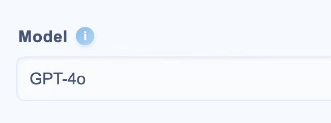
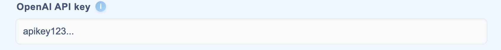
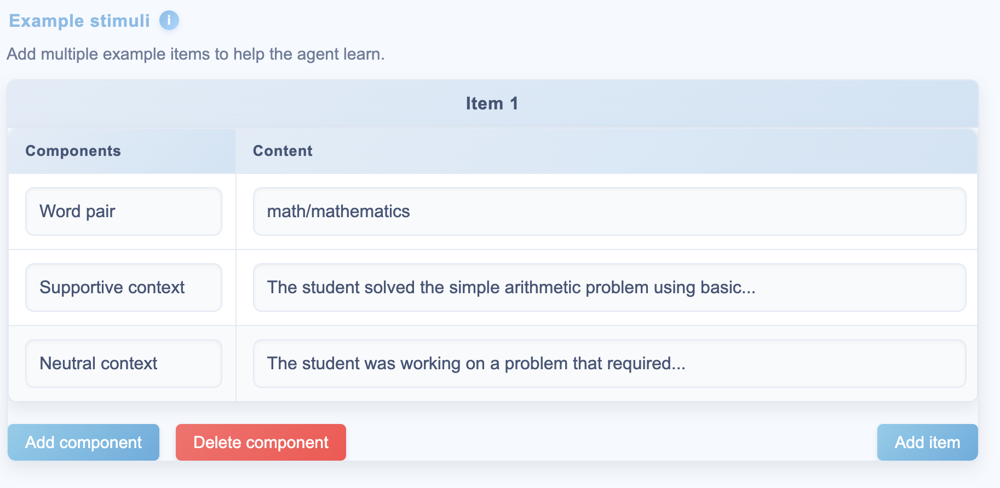
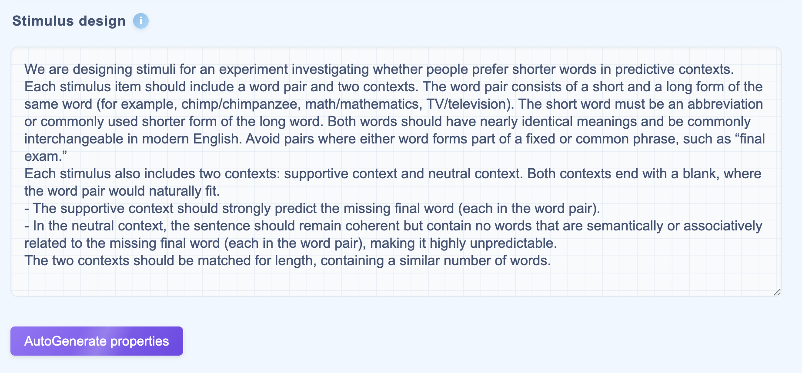
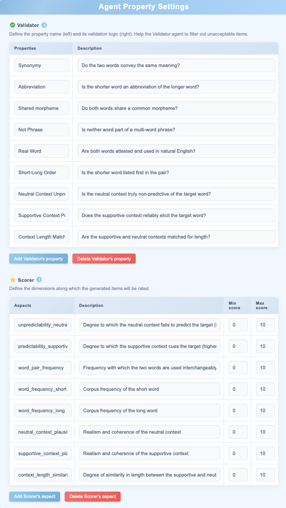
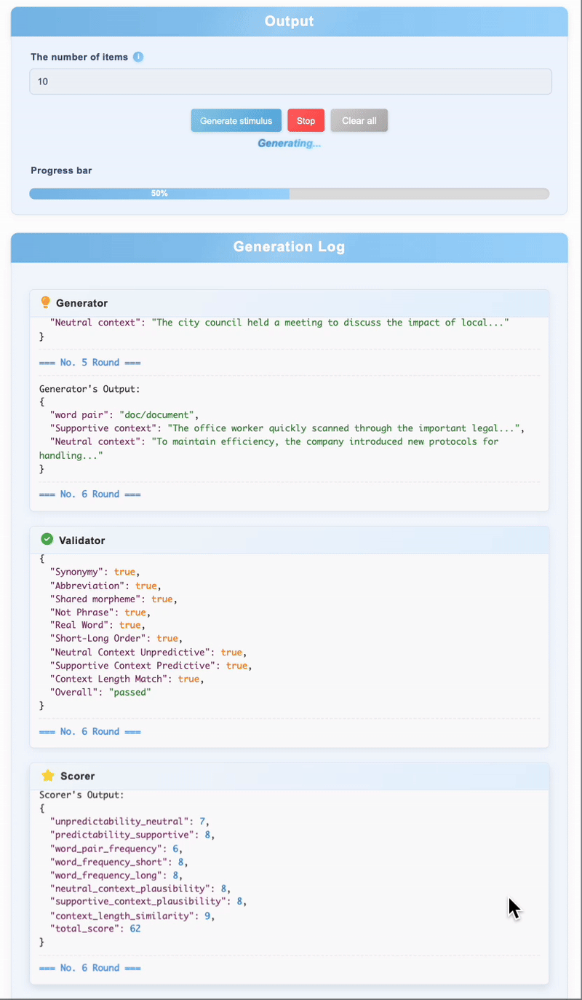
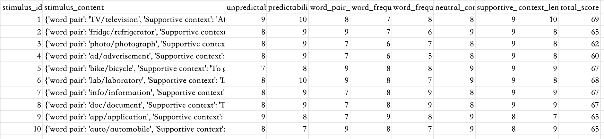

# 🧠 Stimulus Generator

<div align="center">


[](https://github.com/xufengduan/Stimuli_generator)

</div>

<p align="center">
  <b>A Large Language Model-based Stimulus Material Generation Tool for Psycholinguistic Research</b>
</p>

<div align="center">
  <a href="#english">English</a> | <a href="#chinese" onclick="document.getElementById('chinese-content').open = true;">中文</a>
</div>

---

<a id="english"></a>
## 📖 Project Introduction

Stimulus Generator is a tool based on large language models designed specifically for psycholinguistic research to generate stimulus materials. It can automatically generate experimental stimulus materials that meet requirements based on the experimental design and examples defined by researchers. This tool adopts a multi-agent architecture, including Generator, Validator, and Scorer, to ensure that the generated stimulus materials meet experimental requirements and are of high quality.

## ✨ Main Features

- **🤖 Multi-agent Architecture**:
  - **Generator**: Generates stimulus materials based on experimental design
  - **Validator**: Verifies whether the generated materials meet experimental requirements
  - **Scorer**: Scores materials in multiple dimensions

- **🔄 Flexible Model Selection**:
  - Supports OpenAI GPT-4o (requires OpenAI API Key)
  - Supports Custom Models via OpenAI-compatible APIs (e.g., DeepSeek, Qwen, Meta Llama, Mistral, etc.)

- **📊 Real-time Progress Monitoring**:
  - WebSocket real-time updates of generation progress
  - Detailed log information display
  - Generation process can be stopped at any time

- **🎨 User-friendly Interface**:
  - Intuitive form design
  - Real-time validation and feedback
  - Responsive layout design
  - Detailed help information

## 💻 System Requirements

| Requirement | Details |
|-------------|---------|
| Python | 3.8 or higher |
| Browser | Modern web browser (Chrome, Firefox, Safari, etc.) |
| Network | Stable network connection |
| Socket.IO | Client version 4.x (compatible with server side) |

## 🚀 Installation Instructions

### Clone directly from GitHub repository

```bash
# 1. Clone the project code
git clone https://github.com/xufengduan/Stimuli_generator.git
cd Stimuli_generator

# 2. Create and activate a virtual environment (recommended)
python -m venv venv

# Windows
venv\Scripts\activate
# Linux/Mac
source venv/bin/activate

# 3. Install required dependencies
pip install -e .
```

## 📝 Usage Instructions

### Launch Web Interface

After installation, you can use the command-line tool to start the web interface:

```bash
stimulus-generator webui
```
By default, the web interface will run at http://127.0.0.1:5001.

### Command Line Arguments

```bash
stimulus-generator webui --port 5001
```

| Argument | Description |
|----------|-------------|
| `--host` | Specify host address (default: 0.0.0.0) |
| `--port` | Specify port number (default: 5001) |
| `--debug` | Enable debug mode |
| `--share` | Create public link (requires additional dependencies) |

## 🎯 Usage Steps

### 1. Configure Generation Parameters

#### 1.1 Select Language Model


Choose between:
- GPT-4o (OpenAI)
- Custom Model (enter API URL and model name; supports DeepSeek, Qwen, Meta Llama, Mistral, etc.)

#### 1.2 Enter API Key (as required by your provider)


Enter the API Key for the selected provider (e.g., OpenAI, DeepSeek, etc.) in the designated field.

#### 1.3 Add Example Stimulus Materials


Components are the building blocks of your stimuli. For example, in a study investigating contextual predictability on word choice:
- A word pair (e.g., math/mathematics)
- Supportive context (high predictability)
- Neutral context

Each component should be filled with its corresponding content. For instance:
- Word pair: "math/mathematics"
- Supportive context: "The student solved the simple arithmetic problem using basic..."
- Neutral context: "The student was working on a problem that required..."

To add more examples:
1. Complete all components for the first item
2. Click "Add Item" in the bottom right corner
3. Repeat for additional examples (recommended: at least 3 examples)

#### 1.4 Fill in Experimental Design Description


When writing your experimental design description, include these key components:

1. **Purpose of the Stimuli**
   - Explain the experiment's goal
   - Describe how the stimuli support this goal
   - Example: "We are designing stimuli for an experiment investigating whether people prefer shorter words in predictive contexts."

2. **Core Structure of Each Stimulus Item**
   - Describe the components of each item
   - Example: "Each stimulus item includes a word pair and two contexts."

3. **Detailed Description of Each Element**
   For each component, specify:
   - What it is
   - How it's constructed
   - What constraints apply
   - What to avoid
   - Example: "The word pair consists of a short and a long form of the same word... Avoid pairs where either word forms part of a fixed or common phrase."

4. **Experimental Conditions or Variants**
   Explain:
   - Definition of each condition
   - Construction criteria
   - Matching constraints
   - Example: "The supportive context should strongly predict the missing final word... The two contexts should be matched for length."

5. **Example Item**
   Include at least one complete example with labeled parts.

6. **Formatting Guidelines**
   Note any specific formatting or submission requirements.

#### 1.5 Review Auto-generated Properties


After completing the experimental design:
1. Click "Auto-generate Properties"
2. The system will automatically set:
   - Validation conditions
   - Scoring dimensions
3. **Important**: Review and adjust these auto-generated properties as needed

### 2. Start Generation


1. Click the "Generate stimulus" button
2. Monitor progress in real-time
3. View detailed logs
4. Use "Stop" button if needed

### 3. Get Results


- CSV file automatically downloads upon completion
- Contains generated materials and scores

## 📂 File Structure

```
Stimulus-Generator/
├── stimulus_generator/    # Main Python package
│   ├── __init__.py        # Package initialization file
│   ├── app.py             # Flask backend server
│   ├── backend.py         # Core backend functionality
│   └── cli.py             # Command line interface
├── run.py                 # Quick start script
├── setup.py               # Package installation configuration
├── static/
│   ├── script.js          # Frontend JavaScript code
│   ├── styles.css         # Page stylesheet
│   └── Stimulus Generator Web Logo.png  # Website icon
├── webpage.html           # Main page
├── requirements.txt       # Python dependency list
└── README.md              # Project documentation
```

## 🛠️ Command Line Tools

After installation, you can use the following command-line tools:

```bash
# Launch web interface
stimulus-generator webui [--host HOST] [--port PORT] [--debug] [--share]

# View help
stimulus-generator --help
```

If you don't want to install, you can also run directly:

```bash
# After cloning the repository, run in the project directory
python run.py webui
```

## ⚠️ Notes

1. **API Key Security**:
   - Please keep your OpenAI API Key secure
   - Do not expose API Keys in public environments

2. **Generation Process**:
   - Generation process may take some time, please be patient
   - You can monitor generation status in real time through the log panel
   - You can stop generation at any time if there are issues

3. **Results Usage**:
   - It is recommended to check if the generated materials meet experimental requirements
   - Manual screening or modification of generated materials may be needed

## ❓ FAQ

<details>
<summary><b>What to do if the generation process gets stuck?</b></summary>
<br>
- Check if the network connection is normal
- Click the "Stop" button to stop the current generation
- Refresh the page to restart
- If the page is unresponsive for a long time, wait for 30 seconds and the system will automatically unlock the interface
</details>

<details>
<summary><b>How to solve WebSocket connection errors?</b></summary>
<br>
- Ensure that the network environment does not block WebSocket connections
- If you see WebSocket error messages, refresh the page to re-establish the connection
- Restart the server or try using a different browser
- WebSocket connection issues will not affect main functionality, the system has automatic recovery mechanisms
</details>

<details>
<summary><b>How to optimize generation quality?</b></summary>
<br>
- Provide more detailed examples
- Improve experimental design description
- Set appropriate validation conditions
</details>

<details>
<summary><b>How to handle slow generation speed?</b></summary>
<br>
- Consider reducing the number of items to generate
- Ensure stable network connection
- Choose a model with faster response
</details>

## 📞 Technical Support

For questions or suggestions, please contact:
- Submit an [Issue](https://github.com/xufengduan/Stimuli_generator/issues)
- Send an email to: ...

## 📄 License

This project is licensed under the [Apache License 2.0](LICENSE). See the LICENSE file for details.

---

<details id="chinese-content">
<summary><a id="chinese"></a>中文版本 (Chinese Version)</summary>

## 📖 项目简介

Stimulus Generator 是一个基于大语言模型的刺激材料生成工具，专门为心理语言学研究设计。它能够根据研究者定义的实验设计和示例，自动生成符合要求的实验刺激材料。该工具采用多代理架构，包含生成器(Generator)、验证器(Validator)和评分器(Scorer)三个代理，确保生成的刺激材料满足实验要求并具有良好的质量。

## ✨ 主要特点

- **🤖 多代理架构**：
  - **Generator**：根据实验设计生成刺激材料
  - **Validator**：验证生成的材料是否符合实验要求
  - **Scorer**：对材料进行多维度评分

- **🔄 灵活的模型选择**：
  - 支持 OpenAI GPT-4o（需要 OpenAI API Key）
  - 支持自定义模型（通过 OpenAI 兼容 API；如 DeepSeek、Qwen、Meta Llama、Mistral 等）

- **📊 实时进度监控**：
  - WebSocket 实时更新生成进度
  - 详细的日志信息显示
  - 可随时停止生成过程

- **🎨 用户友好界面**：
  - 直观的表单设计
  - 实时验证和反馈
  - 响应式布局设计
  - 详细的帮助信息提示

## 💻 系统要求

| 要求 | 详情 |
|------|------|
| Python | 3.8 或更高版本 |
| 浏览器 | 现代网页浏览器（Chrome、Firefox、Safari 等） |
| 网络 | 稳定的网络连接 |
| Socket.IO | 客户端版本 4.x（与服务器端兼容） |

## 🚀 安装说明

### 直接从GitHub仓库中克隆

```bash
# 1. 克隆项目代码
git clone https://github.com/xufengduan/Stimuli_generator.git
cd Stimuli_generator

# 2. 创建并激活虚拟环境（推荐）
python -m venv venv

# Windows
venv\Scripts\activate
# Linux/Mac
source venv/bin/activate

# 3. 安装项目所需依赖
pip install -e .
```

## 📝 使用说明

### 启动Web界面

安装完成后，可以直接使用命令行工具启动Web界面：

```bash
stimulus-generator webui
```

默认情况下，Web界面将在 http://127.0.0.1:5001 上运行。

### 命令行参数

```bash
stimulus-generator webui --port 5001
```

| 参数 | 描述 |
|------|------|
| `--host` | 指定主机地址（默认：0.0.0.0） |
| `--port` | 指定端口号（默认：5001） |
| `--debug` | 启用调试模式 |
| `--share` | 创建公共链接（需要安装额外依赖） |

## 🎯 使用步骤

### 1. 配置生成参数

#### 1.1 选择语言模型


可选择：
- GPT-4o（OpenAI）
- 自定义模型（填写 API URL 和模型名称；支持 DeepSeek、Qwen、Meta Llama、Mistral 等）

#### 1.2 输入 API Key（根据所选模型提供商）


请在指定字段中输入所选提供商（如 OpenAI、DeepSeek 等）的 API Key。

#### 1.3 添加示例刺激材料


组件（Components）是刺激材料的组成部分。例如，在研究语境可预测性对词汇选择的影响时：
- 词对（例如：math/mathematics）
- 支持性语境（高可预测性）
- 中性语境

每个组件都需要填写相应的内容。例如：
- 词对："math/mathematics"
- 支持性语境："学生使用基本的算术解决了这个简单的问题..."
- 中性语境："学生正在解决一个需要..."

添加更多示例：
1. 完成第一个项目的所有组件
2. 点击右下角的"添加项目"按钮
3. 重复上述步骤添加更多示例（建议至少添加3个示例）

#### 1.4 填写实验设计说明


在编写实验设计说明时，请包含以下关键部分：

1. **刺激材料的目的**
   - 解释实验目标
   - 描述刺激材料如何支持这个目标
   - 示例："我们正在设计用于研究人们在可预测语境中是否倾向于使用较短词汇的实验刺激材料。"

2. **每个刺激项目的核心结构**
   - 描述每个项目的组成部分
   - 示例："每个刺激项目包含一个词对和两个语境。"

3. **每个元素的详细描述**
   对于每个组件，请说明：
   - 它是什么
   - 如何构建
   - 适用的约束条件
   - 需要避免的内容
   - 示例："词对由同一个词的短形式和长形式组成...避免使用固定搭配或常见短语中的词。"

4. **实验条件或变体**
   说明：
   - 每个条件的定义
   - 构建标准
   - 匹配约束
   - 示例："支持性语境应该强烈预测缺失的最后一个词...两个语境应该在长度上匹配。"

5. **示例项目**
   包含至少一个完整的示例，并标注各个部分。

6. **格式指南**
   注明任何特定的格式或提交要求。

#### 1.5 检查自动生成的属性


完成实验设计后：
1. 点击"自动生成属性"按钮
2. 系统将自动设置：
   - 验证条件
   - 评分维度
3. **重要**：请检查并根据需要调整这些自动生成的属性

### 2. 开始生成


1. 点击"生成刺激材料"按钮
2. 实时监控进度
3. 查看详细日志
4. 必要时使用"停止"按钮

### 3. 获取结果


- 完成后自动下载 CSV 格式的结果文件
- 包含生成的刺激材料及其评分

## 📂 文件结构

```
Stimulus-Generator/
├── stimulus_generator/    # 主Python包
│   ├── __init__.py        # 包初始化文件
│   ├── app.py             # Flask 后端服务器
│   ├── backend.py         # 后端核心功能
│   └── cli.py             # 命令行接口
├── run.py                 # 快速启动脚本
├── setup.py               # 包安装配置
├── static/
│   ├── script.js          # 前端 JavaScript 代码
│   ├── styles.css         # 页面样式表
│   └── Stimulus Generator Web Logo.png  # 网站图标
├── webpage.html           # 主页面
├── requirements.txt       # Python 依赖列表
└── README.md              # 项目说明文档
```

## 🛠️ 命令行工具

安装后，可以使用以下命令行工具：

```bash
# 启动Web界面
stimulus-generator webui [--host HOST] [--port PORT] [--debug] [--share]

# 查看帮助
stimulus-generator --help
```

如果您不想安装，也可以直接使用以下方式运行：

```bash
# 克隆仓库后，在项目目录中运行
python run.py webui
```

## ⚠️ 注意事项

1. **API 密钥安全**：
   - 请妥善保管您的 OpenAI API Key
   - 不要在公共环境中暴露 API Key

2. **生成过程**：
   - 生成过程可能需要一定时间，请耐心等待
   - 可以通过日志面板实时监控生成状态
   - 如遇到问题可以随时停止生成

3. **结果使用**：
   - 建议检查生成的材料是否符合实验要求
   - 可能需要对生成的材料进行人工筛选或修改

## ❓ 常见问题

<details>
<summary><b>生成过程卡住怎么办？</b></summary>
<br>
   - 检查网络连接是否正常
   - 点击 "Stop" 按钮停止当前生成
   - 刷新页面重新开始
   - 如果页面长时间无响应，可以等待30秒，系统会自动解除界面锁定
</details>

<details>
<summary><b>WebSocket连接错误如何解决？</b></summary>
<br>
   - 确保网络环境没有阻止WebSocket连接
   - 如果看到WebSocket错误信息，可以刷新页面重新建立连接
   - 重启服务器或尝试使用不同的浏览器
   - WebSocket连接问题不会影响主要功能，系统有自动恢复机制
</details>

<details>
<summary><b>如何优化生成质量？</b></summary>
<br>
   - 提供更多详细的示例
   - 完善实验设计说明
   - 设置合适的验证条件
</details>

<details>
<summary><b>生成速度较慢怎么处理？</b></summary>
<br>
   - 考虑减少生成数量
   - 确保网络连接稳定
   - 选择响应更快的模型
</details>

## 📞 技术支持

如有问题或建议，请通过以下方式联系：
- 提交 [Issue](https://github.com/xufengduan/Stimuli_generator/issues)
- 发送邮件至：...

## 📄 许可证

本项目采用 [Apache License 2.0](LICENSE) 许可证。详见 LICENSE 文件。

</details>

## Reliability and interface update (2026-11-17)

The generation → validation → scoring → CSV workflow and repetition rule remain
unchanged. Validation now requires complete boolean responses, failed scores are
exported as missing values with an error marker, provider failures have bounded
retries, and active jobs cannot be replaced by duplicate submissions. Downloads
can be retried, and legacy saved stimulus content is supported. API subprocess
handling and untrusted HTML output are fixed. Custom endpoints are restricted to
public HTTP(S) addresses, pinned to checked IPs with TLS verification; redirects
are rejected.

Prompts now clarify JSON output, boolean criteria, and dimension-specific score
direction. Prompt wording and effective sampling settings can affect outputs;
record this revision when comparing with earlier results.

The interface defaults to Custom Model (including after Clear all), provides a
read-only component example and a four-column API reference for DeepSeek,
OpenRouter and OpenAI. OpenAI examples use `gpt-5.4` and `openai/gpt-5.4`.
For these two model IDs, requests default to no reasoning so sampling parameters
remain supported; explicit higher reasoning effort is retained and incompatible
sampling parameters are omitted. Existing GPT-4o mode is retained for compatibility.
Model IDs are examples; check provider availability.

Install development dependencies and run regression checks from the repository:

```sh
python -m pip install -r requirements-dev.txt
python -m pytest -q
node tests/test_frontend.cjs
```

The Python package structure, `python run.py` and `stimulus-generator webui` entry
points are preserved. Tests use simulated API responses and do not consume credits.


The model reference separates Provider, URL, Model name, and API-key links into
four columns. Custom parameters are prefilled with
`{"max_tokens": 2000, "temperature": 0.7}` and restored by Clear all. GPT-5.4
requests sent directly to OpenAI translate `max_tokens` to
`max_completion_tokens`; OpenRouter keeps its supported `max_tokens` parameter.
